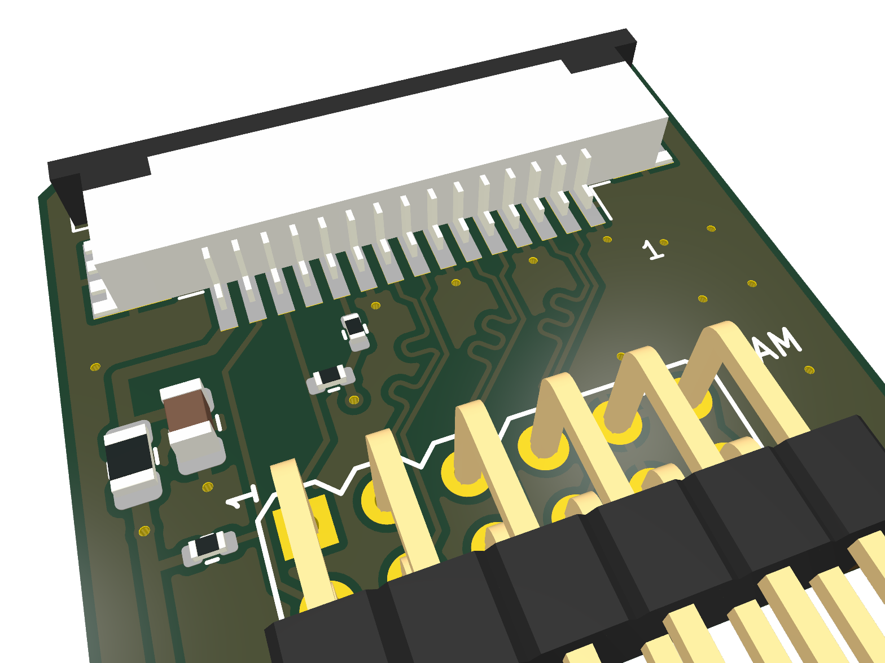
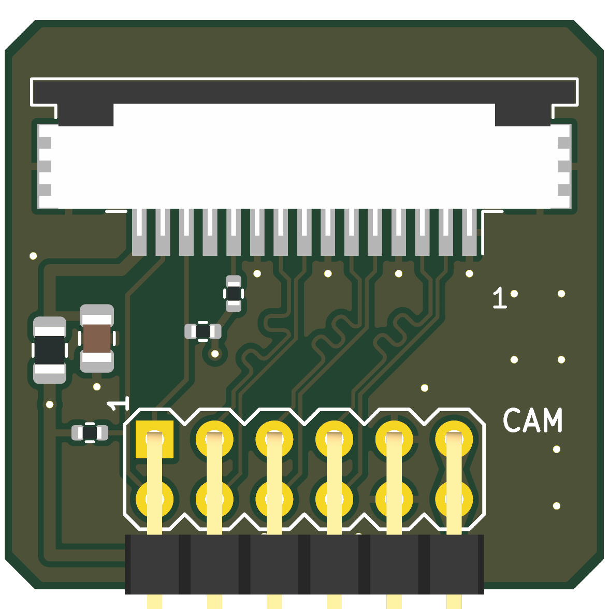

# Pmod RPi Camera (Rev. A)

Raspberry Pi カメラ (15 ピン 1.0 mm FFC, 2 レーン MIPI CSI-2) を Pmod 1 個につなぐ変換基板。
FPGA 側はソフト D-PHY (`eda/csi_capture`, `rtl/csi2`)。KiCad 10。

 

状態: **設計のみ (未発注・実機未確認)**。ERC / DRC (回路図との一致を含む) はエラー 0。

## 仕様

- 外形 25.4 × 24.13 mm、2 層 1.6 mm (FR4)、角 1.27 mm 面取り。
  FFC コネクタの本体が 22 mm あるので Pmod 標準幅 (20.32 mm) より片側 2.5 mm 程度はみ出す
- J1: Pmod 2x6 直角ヘッダ (TangFPGAExtensions の `Conn_Pmod_Spec_B_Thin`)、基板下端
- J2: TE 1-84952-5 (15 ピン 1.0 mm FFC、**下面接点**、ZIF)、基板上端、ケーブルは上から挿す
- CSI 3 対: 差動 100Ω (Pmod_DisplayPort と同じ Link クラス 0.1661 / 0.127 mm)、
  F.Cu のみ・ビアなし、B.Cu は全面 GND (3.3V の短いストラップは I2C の下だけ)。
  P/N の長さ差 ~2.5 mm (~17 ps) は 1 Gbps 以下では無視できる
- F1: ポリスイッチ 0.5 A (カメラの 3.3V)、C1: 10 µF、R1/R2: I2C プルアップ 2.2k、R3: CAM_GPIO プルアップ 10k
- 直列抵抗・AC 結合・バイアス抵抗なし (D-PHY は DC 結合が必須、終端は FPGA 内蔵)

## ピン割り当て

| Pmod | 信号 | FFC | Tang Primer 25K (pmod0) |
|---|---|---|---|
| 1 / 7 | SCL / SDA | 13 / 14 | F5 / G5 |
| 2 / 8 | CLK P / N | 9 / 8 | G7 / G8 |
| 3 / 9 | D1 P / N | 6 / 5 | H8 / H7 |
| 4 / 10 | D0 P / N | 3 / 2 | H5 / J5 |
| 5, 11 | GND | 1, 4, 7, 10, MP | |
| 6, 12 | 3.3 V | 15 (F1 経由) | |
| — | CAM_GPIO | 11 | R3 で 3.3 V へ (カメラは Pmod 給電で即起動) |
| — | CAM_CLK | 12 | 未接続 |

FFC のピン配置は Raspberry Pi 4 公式回路図 (J3 CAMERA) で確認。Pmod 上の並び (CLK, D1, D0) は
FFC 上の並びと同じ順にして、差動対が交差しないようにしてある (FPGA の `pins.cst` も同じ割り当て)。
FPGA 側の定義は `mod/pmod_rpi_camera/pmod_pins.csv`。

## ケーブルの向き (要確認)

15 ピン FFC は「接点が両端で同じ面」(Type A) のケーブルが標準だが、本基板とカメラ基板の
コネクタの組み合わせでピン 1 がどちら側に来るかは、実物で確認できていない。
逆だとカメラの GND (1 番) に本基板の 3.3V (15 番) が当たるので、F1 で保護してある。

**組み立て前の確認** (カメラをつながずに):
1. ケーブルを J2 に挿し、ケーブル反対端の導体 1 番 (カメラ基板の GND 側) と Pmod の GND (5/11 番) の
   導通をテスタで見る。導通すれば正しい向き
2. 逆なら J2 を上面接点の **TE 1-84953-5** (フットプリント同一) に替え、ケーブルを裏返して挿す

## 製造データ

`tools/build.sh` が回路図と基板を再生成し、ERC / DRC を通してから `fab/` を作る:

| ファイル | 内容 |
|---|---|
| `fab/Pmod_RPiCamera_gerber.zip` | ガーバー (F/B Cu, Mask, Silk, F.Paste, Edge) + ドリル (PTH/NPTH 別) |
| `fab/Pmod_RPiCamera_bom.csv` | 部品表 |
| `fab/Pmod_RPiCamera_pos.csv` | 実装位置 (表面のみ) |
| `fab/Pmod_RPiCamera_schematic.pdf` | 回路図 |
| `fab/*.png` | 3D レンダリング |
| `fab/erc.rpt`, `fab/drc.rpt` | 検査結果 (ライブラリ表の警告はヘッドレス環境由来) |

回路図・基板の初版は `tools/gen_sch.py` / `tools/gen_pcb.py` で生成し、その後 KiCad で手を入れている
(rev A: P 側の等長化ミアンダ、ティアドロップ)。**KiCad のファイルが正**。`tools/build.sh` は既定で
現状のファイルを検査して出力するだけ。`--regen` を付けるとスクリプトから作り直し、KiCad での修正は消える。

## 部品

| Ref | 部品 | 備考 |
|---|---|---|
| J1 | 2x6 2.54 mm 直角ピンヘッダ | |
| J2 | TE 1-84952-5 (下面接点) / 1-84953-5 (上面接点) | 同一フットプリント。JUSHUO AFA07-S15FCA-00 等の互換品はフットプリントが異なる |
| F1 | 0805 PTC、I_hold 0.5 A、6 V 以上 | 例: Littelfuse 0805L050 (型番は要確認) |
| C1 | 10 µF 10 V X5R 0805 | |
| R1, R2 | 2.2 kΩ 0402 | |
| R3 | 10 kΩ 0402 | |

## 未確定事項

- 差動インピーダンスは DP 基板の実績値を流用 (2 層 1.6 mm でのペア結合主体)。製造業者のスタックアップで要再計算
- FFC ケーブル向き (上記)。カメラ v2 の消費電流 (~250 mA 程度の見込み) に対する F1 の定格
- GW5A LVDS25 入力のコモンモード下限 (SLVS-200 は ~200 mV) は FPGA 側の最大リスク (`../../README.md`)
