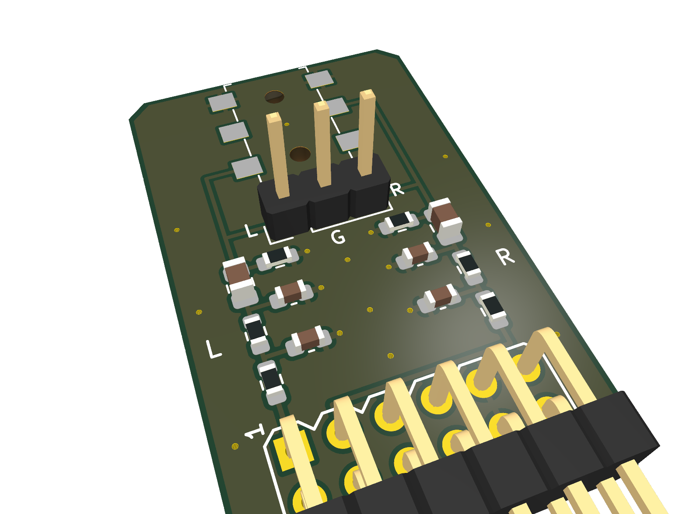
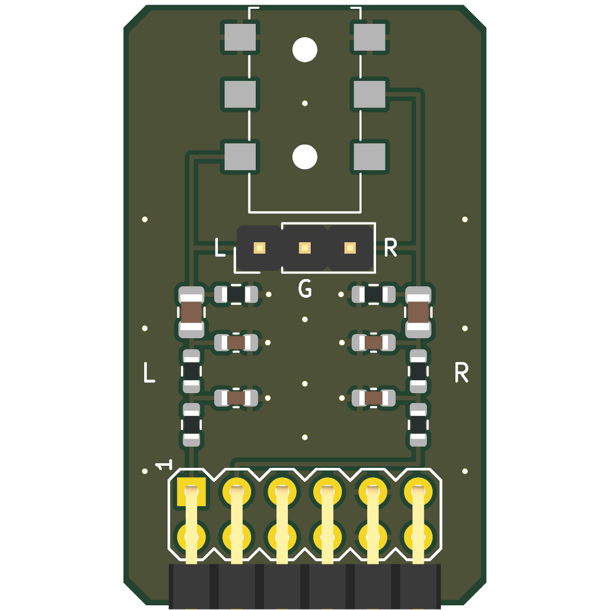
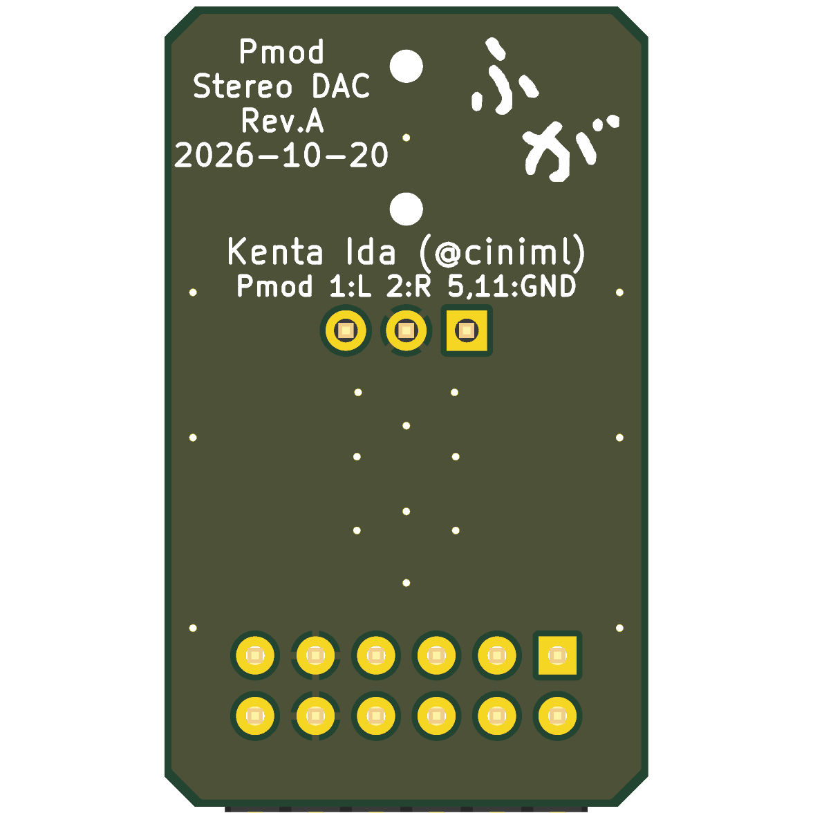

# Pmod Stereo DAC (Rev. A)

`eda/dvi_hub75` (`rtl/hdmi_rx`) の 1 bit ΔΣ DAC 出力 2 本 (L / R) を、RC ローパスと直流カットを通して
3.5 mm ステレオジャック (と 3 ピンヘッダ) に出す Pmod 基板。ライン出力。KiCad 10。

  

状態: **設計のみ (未発注・実機未確認)**。ERC / DRC (回路図との一致、ベタ再充填込み) はエラー 0。

## 回路 (チャネルごと、`eda/dvi_hub75/README.md` の LPF そのまま)

```
Pmod 1 (L) / 2 (R) ─ R1 1kΩ ─┬─ R2 10kΩ ─┬─ C3 1µF ─┬─→ ジャック (L = チップ / R = リング) と J3 (1 = L / 3 = R)
                             C1 3.3nF     C2 330pF   R3 100kΩ
                             │            │          │
                            GND          GND        GND
```

| 部品 | L | R | 値 |
|---|---|---|---|
| 1 段目 R / C | R1 / C1 | R11 / C11 | 1 kΩ / 3.3 nF C0G (約 48 kHz) |
| 2 段目 R / C | R2 / C2 | R12 / C12 | 10 kΩ / 330 pF C0G (約 48 kHz) |
| 直流カット | C3 | C13 | 1 µF X7R 50 V (0805) |
| ブリーダ | R3 | R13 | 100 kΩ (出力側の直流を 0 V に固定、抜き差しのポップ防止) |

- 周波数特性 (ピンの出力インピーダンス 30 Ω 込み、dvi_hub75 の計算): −3 dB 28.5 kHz、20 kHz で −1.6 dB、
  1 MHz で −53 dB、ΔΣ の更新周波数 6.19 MHz で −85 dB
- 20 kHz まで平坦にしたいなら C1 / C11 = 2.2 nF、C2 / C12 = 220 pF (−3 dB 約 43 kHz、20 kHz で −0.7 dB、
  6.19 MHz で約 −77 dB)。基板はそのまま、部品の値だけ変える
- 低域: C3 と R3 / 負荷 (47 kΩ 以上を想定) で −3 dB は 2〜4 Hz
- **ライン出力** (フルスケール正弦波で約 1.1 Vrms、出力インピーダンス約 10 kΩ)。**ヘッドホンは直接鳴らせない**
  (アンプ付きスピーカー、オーディオインターフェースのライン入力、ヘッドホンアンプにつなぐ)
- 音質は FPGA の I/O 電源のノイズで決まる (ΔΣ の出力は I/O 電源の電圧そのもの)。改善策は dvi_hub75 の README
  (静かな電源のフリップフロップで打ち直す) を参照。本基板は受動部品のみで 3.3 V は使わない

## コネクタ

| Pmod | 信号 | 備考 |
|---|---|---|
| 1 | AUDIO_L (ΔΣ 左) | |
| 2 | AUDIO_R (ΔΣ 右) | |
| 5, 11 | GND | |
| 3, 4, 7–10, 6 / 12 (3.3 V) | 未接続 | |

- J2: 3.5 mm ステレオジャック SHOU HAN **PJ-313D** (SMD、LCSC C668608)。チップ = L、リング = R、スリーブ = GND。
  プラグ挿入口は基板上端 (本体前面が基板端、ノーズ 2.5 mm がはみ出す)。各接点は 2 本足 (両側) で、
  フットプリントでは同じ番号のパッドを内部接続扱い (duplicate pad numbers are jumpers) にしてある
- J3: 1×3 2.54 mm ピンヘッダ (縦、LCSC C49257)、**1 = L、2 = GND、3 = R** (シルク L / G / R、ピン 1 は角パッド)。
  ジャックと並列 (直流カットの後、ブリーダ付き)。GND が中央なので、逆向きに挿しても L と R が短絡しない
- J1: Pmod 2×6 直角ヘッダ (TangFPGAExtensions の `Conn_Pmod_Spec_B_Thin`)、基板下端、ピン 1 左

FPGA 側の定義は `mod/pmod_stereo_dac/pmod_pins.csv` (dac_l = pmodN_1、dac_r = pmodN_2)。

### eda/dvi_hub75 で使う場合

dvi_hub75 は ΔΣ を J4 (40 ピンヘッダ) の 19 / 20 番 = D1 / E3 から出している。Tang Primer 25K の Pmod 3 スロットは
すべて使用中 (pmod0 = Pmod DVI、pmod1 / pmod2 = HUB75 ベースボード) なので、この基板は **J4 から Pmod を
取り出すアダプタ** (`eda/targets/tangprimer25k/hw` で別途設計中の J4 → Pmod 変換基板) に挿す。
`eda/dvi_hub75/src/tangprimer25k/pins.cst` の `dac_l` / `dac_r` の IO_LOC を、そのアダプタで本基板の
ピン 1 / 2 が来る FPGA ピンに変える (dvi_hub75 の設計自体はまだ変えていない)。
J4 19 / 20 番がアダプタの Pmod ピン 1 / 2 に来る配置なら pins.cst の変更は不要。

## 基板

- 外形 20.32 × 33.6 mm (Pmod 1 スロット幅)、2 層 1.6 mm、角 1.27 mm 面取り
- 2 チャネルを左右の列に配置 (L は Pmod ピン 1 の真上、R は鏡像)。直列部品は列上、信号は下から上 (ジャック側) へ。
  シャント部品 (C1 / C2 / R3) は列の内側に置き、それぞれ専用の GND ビアで裏面の全面 GND へ落とす
- 部品は 0603 (C3 / C13 のみ 0805)、手はんだも可
- 裏面: ロゴ、「Pmod / Stereo DAC / Rev.A / 2026-10-20」「Kenta Ida (@ciniml)」、Pmod ピンの凡例

## 部品 (LCSC / JLCPCB、2026-10-20 時点)

| Ref | 部品 | LCSC | 備考 |
|---|---|---|---|
| R1, R11 | UNI-ROYAL 0603WAF1001T5E (1 kΩ) | C21190 | JLC Basic。LCSC 在庫 0 → 購入リストは YAGEO RC0603FR-071KL (C22548) |
| R2, R12 | UNI-ROYAL 0603WAF1002T5E (10 kΩ) | C25804 | JLC Basic |
| R3, R13 | UNI-ROYAL 0603WAF1003T5E (100 kΩ) | C25803 | JLC Basic |
| C1, C11 | YAGEO CC0603JRNPO9BN332 (3.3 nF C0G) | C107048 | |
| C2, C12 | Samsung CL10C331JB8NNNC (330 pF C0G) | C1664 | JLC Basic |
| C3, C13 | Samsung CL21B105KBFNNNE (1 µF X7R 50 V 0805) | C28323 | JLC Basic。LCSC 在庫 0 → 購入リストは YAGEO CC0805KKX7R9BB105 (C91185) |
| J2 | SHOU HAN PJ-313D | C668608 | |
| J3 | BOOMELE 2.54-1*3P | C49257 | 手はんだ可 |
| J1 | 2×6 2.54 mm 直角ピンヘッダ | — | 手はんだ想定 (購入リストには候補 C41417354、寸法はフットプリントと要照合) |

## 製造データ (`tools/build.sh`)

| ファイル | 内容 |
|---|---|
| `fab/Pmod_StereoDAC_gerber.zip` | ガーバー + ドリル (PTH / NPTH 別) |
| `fab/Pmod_StereoDAC_bom.csv`, `_pos.csv` | 部品表 (LCSC / MPN 付き)、実装位置 (原点は基板左下) |
| `fab/jlc/` | JLCPCB 実装用 BOM / CPL (LCSC 番号のある部品。J3 は THT) |
| `fab/lcsc/Pmod_StereoDAC_lcsc_5pcs.csv` | LCSC 購入リスト 5 枚分 (`tools/lcsc_order.py N`、LCSC 在庫切れは同等品に自動置換) |
| `fab/Pmod_StereoDAC_schematic.pdf`, `*.png` | 回路図、レンダリング |

回路図・基板は `tools/gen_sch.py` / `tools/gen_pcb.py` で生成 (`./tools/build.sh --regen`)。KiCad で手を入れたら
以後は KiCad のファイルが正 (`--regen` は手修正を消す)。

## 未確認・注意

- PJ-313D のフットプリントは SHOU HAN の図面 (2020-08-24) から自作。KiCad 標準ライブラリに該当品が無いため。
  3D モデルは無い (レンダリングにジャックは写らない)。A / B / C 端子 = スリーブ / リング / チップは、
  挿入口に近い順 (A) とデータシートの接続図 (A が本体側) からの判断
- 実機のアナログ特性 (ノイズ、歪み) は未測定 (dvi_hub75 でも LPF 出力は未確認)
