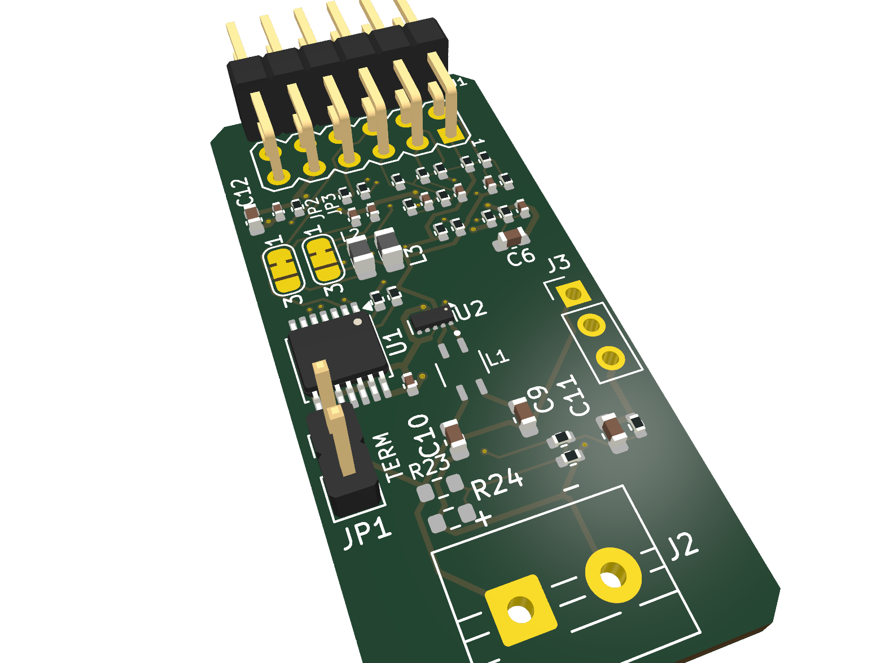
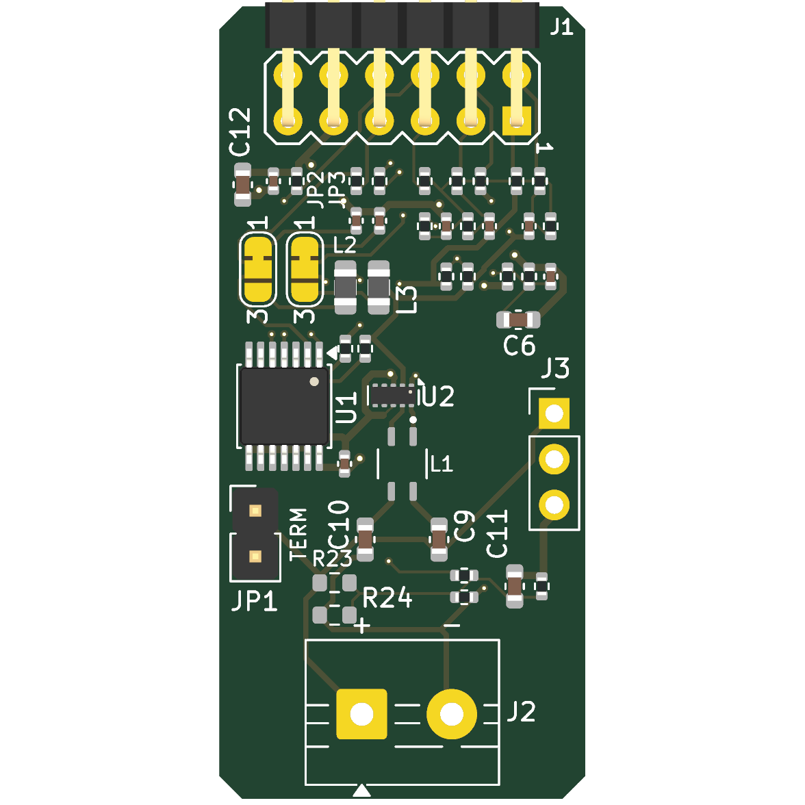
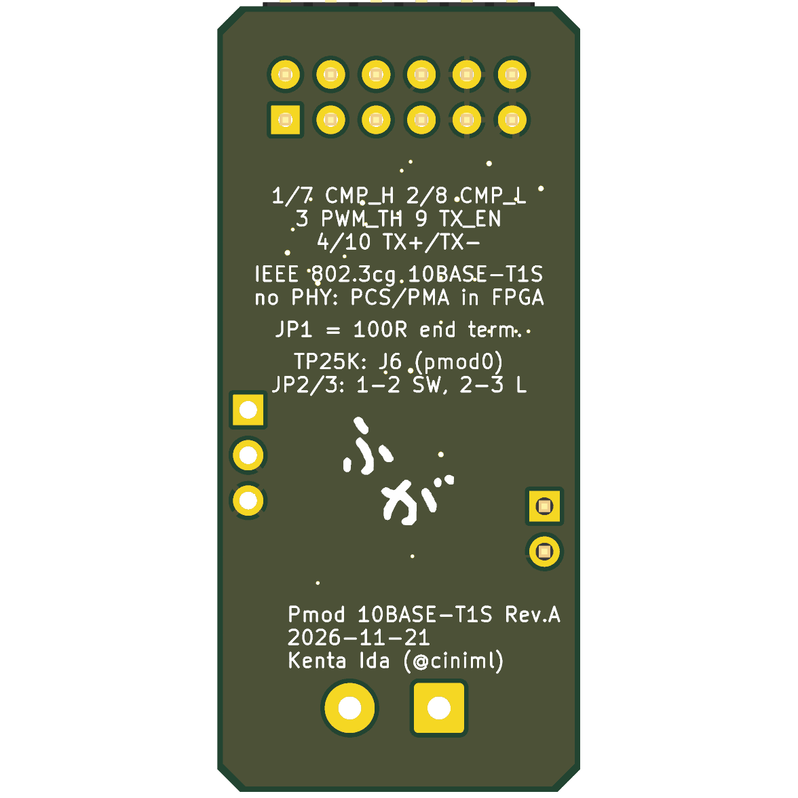

# Pmod 10BASE-T1S (Rev. A)

IEEE 802.3cg 10BASE-T1S のバスに、**PHY チップを使わずに**つなぐ Pmod 基板。PCS / PMA / PLCA は FPGA のロジック
(`rtl/t1s_phy`) で実装し、基板には受動部品と、アナログスイッチ 1 個・CMC・ESD アレイだけを載せる。
送信は「RC + アナログスイッチ」と「直列インダクタ (Basic / Preferred 部品だけ)」の 2 通りを載せてあり、ハンダジャンパで選ぶ。
検討の経緯と規格の要件は [`../../README.md`](../../README.md)。KiCad 10、2 層。

  

状態: **設計のみ (未発注・実機未確認)**。

## 仕様

- 外形 20.32 × 44 mm (Pmod 1 スロット幅)、2 層 1.6 mm (B.Cu は GND ベタ)、角 1.27 mm 面取り。
- J1: Pmod 2x6 直角ヘッダ (`Conn_Pmod_Spec_B_Thin`)、上端。Digilent のピン 1 は部品面から見て右端。
- J2: 5.0 mm 2 ピンねじ端子 (KF301-5.0-2P、フットプリントは互換の MaiXu MX126)、下端。1 = BI_DA+ (シルク「+」)、2 = BI_DA−。
  DME は極性に依存しないので逆につないでも動く。挿入実装なので手はんだを既定にする (`jlc_files.py --with-tht` で JLC 実装に含める)。
- J3: 2.54 mm 3 ピン (線 +、線 −、GND、**未実装**)。プローブやジャンパ線用。
- JP1: 2 ピンヘッダ + ショートピン。**バスの両端のノードだけ**挿して 100 Ω のエンド終端を入れる。
- JP2 / JP3: 3 パッドのハンダジャンパ (TX+ / TX−)。送信経路の選択 (下の「送信経路の切り替え」)。
- 電源: Pmod VCC (3.3 V) のみ。PoDL 非対応 (給電されたバスにつながない)。

| J1 ピン | 信号 | 種類 | TP25K J6 (pmod0) |
|---|---|---|---|
| 1 / 7 | CMP_HP / CMP_HN (比較器 H: v > +th) | LVDS25 入力 | F5 / G5 |
| 2 / 8 | CMP_LP / CMP_LN (比較器 L: v > −th) | LVDS25 入力 | G7 / G8 |
| 3 | PWM_TH (しきい値) | LVCMOS33 出力 | H8 |
| 9 | TX_EN (TMUX1511 SEL1/SEL2、基板で 10 kΩ プルダウン。L 経路では常に Low) | LVCMOS33 出力 | H7 |
| 4 / 10 | TX_P / TX_N | LVCMOS33 出力 DRIVE=16 | H5 / J5 |

並びは `eda/pmod_100base_tx` と同じ (9 番だけ 2 本目の PWM から TX_EN に変更)。

## 回路

| Ref | 値 | 役割 |
|---|---|---|
| R1 / R2 | 100 Ω | 送信の直列抵抗 (FPGA 側、両経路で共通)。SW 経路はピン抵抗 + R1 + Ron + R5 ≈ 145 Ω/片側で、50 Ω (両端終端の並列) に約 1.0 Vpp。実測で合わせる |
| JP2 / JP3 | ハンダジャンパ 3 パッド | 中央 = R1 / R2 の出力。1-2 (出荷時、銅箔で短絡) = SW 経路、2-3 = L 経路 |
| C1 / C2 | 220 pF | SW 経路: 立ち上がりを約 10 ns (20〜80%) に鈍らせる。スイッチの FPGA 側にあるので、休止中はバスから見えない |
| U1 | TMUX1511 | SW 経路: 送信の切り離し (SW1/SW2、SEL = TX_EN)。Ron 2 Ω、COFF 最大 4 pF、電源断でも 3.6 V まで絶縁。SW3/SW4 は未使用 (GND) |
| R5 / R6 | 22 Ω | SW 経路: 送信の直列抵抗 (線路側) |
| L2 / L3 | 1 µH 0805 (Sunlord SDFL2012Q1R0KTF、50 mA) | L 経路: R1 / R2 と直列で立ち上がりを鈍らせ、TRX に直結。直列素子なので休止中に容量として見えない |
| R7 | 10 kΩ | TX_EN のプルダウン (FPGA の未コンフィグ時の弱プルアップでスイッチが入らないように) |
| R8 / R9 | 20 kΩ | TRX_P / TRX_N を VB にバイアス (比較器の VB 側の入力を兼ねる) |
| C4 / C5、R12 / R14 | 100 nF、20 kΩ | 比較器の VTH 側のタップ (AC 結合 + VTH へバイアス) |
| R10 / R11 / R13 / R15 | 1 kΩ | FPGA の各ピンとの直列抵抗 (ピン容量を高域で隠す、ESD 電流の制限) |
| R16 / R17 / C6 / C7 | 3.3 kΩ / 2 kΩ / 10 µF / 100 nF | VB = 1.245 V |
| R18 / R19 / C8 | 5.1 kΩ / 1 kΩ / 1 µF | PWM → VTH。th = VTH − VB = (D × 3.3 V − VB) × 0.164 = −204〜+337 mV |
| U2 | TPD4E02B04 | ESD (トランシーバ側、2 チャネル使用、フロースルー) |
| L1 | ACT1210L-201 (200 µH) | コモンモードチョーク。フットプリントはデータシートの推奨ランドから生成 (`gen_sch.py`) |
| C9 / C10 | 100 nF 50 V | DC 阻止 |
| R20 / R21 / C11 / R22 | 49.9 Ω ×2 / 100 nF / 100 kΩ | エンド終端 (JP1 で入/切) と静電気逃がし (OPEN Alliance の R1/R2/C3/R3) |
| R23 / R24 | 1.5 kΩ (**未実装**) | コモンモード終端 (ドロップノードの任意項目) |
| C12 / C13 / C3 | 10 µF / 100 nF / 100 nF | 3.3 V、U1 の電源 |

## 送信経路の切り替え

| | SW 経路 (JP2 / JP3 = 1-2、出荷時) | L 経路 (JP2 / JP3 = 2-3) |
|---|---|---|
| 回路 | 100 Ω → 220 pF → TMUX1511 → 22 Ω | 100 Ω → 1 µH → TRX 直結 |
| 振幅 (50 Ω) | 約 1.0 Vpp | 1.00〜1.13 Vpp (FPGA のピン抵抗 40〜20 Ω) |
| 立ち上がり (20〜80%、50 Ω‖15 pF) | 約 10 ns | 10.5〜11.8 ns |
| 休止中の high-Z | スイッチで切断 (電源断でも) | FPGA のトライステート。電源断時は DC 阻止の後ろで ±0.25 V しか振れないので FPGA の保護ダイオードはほぼ導通しない |
| 休止中の容量 | TMUX の COFF + 22 Ω | FPGA の TX ピン容量 (推定 5〜10 pF) を 100 Ω + 1 µH 越しに見る。5 pF なら全帯域で下限を満たす (40 MHz で 202 Ω、下限 159 Ω)。10 pF だと直列共振が 50 MHz に下がり、40 MHz で 152 Ω と下限をわずかに割る (`../../tools/calc.py`、要実測) |
| Extended 部品 | TMUX1511 | なし (L2 / L3 は Preferred) |
| FPGA の設定 | `d` = 0 (既定): TX_EN でスイッチ、TX ピンは常に駆動 | `d` = 1: TX_EN は常に Low、TX ピンは P ≠ N の間だけ駆動 (アイドルと PRE / POST はトライステート) |

- 切り替え: 1-2 の間の細い銅箔をカッターで切り、2-3 をハンダでつなぐ。戻すときは 2-3 のハンダを除いて 1-2 をつなぐ。
  L 経路では U1 は載っていてもよい (TX_EN が Low なのでオフ)。
- **発注は両方の経路を載せる構成を既定とする** (`fab/jlc` の BOM / CPL は U1・C1〜C3・R5 / R6 と L2 / L3 をすべて含む)。ジャンパだけで 2 方式を
  実測で比べられるため (TMUX1511 の LCSC 単体の在庫は 2026-11-20 に 0、11-21 に 1,863 個と変動する)。
  コスト (2026-11-21、JLC 少量単価、Extended 手数料 $3/種類): 両方載せると 5 枚で約 $17.1 (部品 $1.62/枚 + 手数料 $9)。
  SW 経路だけなら $16.6、L 経路だけ (U1 / C1〜C3 / R5 / R6 なし) なら $11.4 で、L 経路だけにして減るのは U1 の手数料 $3 と部品 約 $0.43/枚。
  大きく効くのは U2 (ESD) と L1 (CMC) で、手数料 $6 と部品 $0.89/枚 (ただし線路の保護をなくすことになる。L1 を外すには迂回パッドの追加が要る)。
- **SW 経路のまま L2 / L3 が載っていても問題ない** (ジャンパの 3 番が開いているので L は片側が浮く)。逆に L 経路で 1-2 の銅箔を
  切り忘れると、220 pF が L 越しにバスに見えて休止中の容量が規格を大きく超える。
- L 経路の値は ngspice の見積り (`tools/tx_lr.cir`)。FPGA の DRIVE 設定でピン抵抗が変わるので、振幅はオシロで確認する。

## 配線

- 自動配線 (circuitpnr、F.Cu / B.Cu)。ESD アレイの対向パッド (フロースルー) から CMC、CMC から DC 阻止コンデンサまでは
  `tools/gen_pcb.py` で手引き (自動配線が対向パッドの片側を取りこぼすため)。
- 12.5 MBd なので等長・差動インピーダンスは考慮していない。線路系のネット (LINE_*, CM_*, TRX_*) は幅 0.3 mm。

## 生成と製造データ

`tools/build.sh --regen` で回路図・基板を作り直し (gen_sch.py → gen_pcb.py → circuitpnr route / labels)、ERC / DRC
(回路図との一致を含む) のあと `fab/` にガーバー、ドリル、BOM、配置、回路図 PDF、画像を書く。`--regen` なしは今の KiCad ファイルから
製造データだけを出す。生成の流儀は Pmod_DVI / Pmod_GbE と同じ (Python)。

部品 (2026-11-20 照会): TMUX1511PWR は JLC 実装在庫 7,737 個 (LCSC 単体の在庫は 0、11-21 の再照会で 1,863 個)、ACT1210L-201 は 2.6 万個、TPD4E02B04 は 7.2 万個。
2026-11-21 照会: 抵抗は全部 Basic (22 Ω C25092、3.3 kΩ C25890、2 kΩ C4109、5.1 kΩ C25905 に変更)、1 µH の C1042 は Preferred (在庫 6 万個)。
Extended は U1 (TMUX1511)・U2 (ESD)・L1 (CMC)・J2 (ねじ端子、既定で手はんだ) の 4 種類。
`tools/lcsc_order.py N` で手はんだ用の LCSC 購入リスト (`fab/lcsc/`、5 枚分を 2026-11-21 に再生成。C14663 (100 nF 50 V 0603) と C1042 (1 µH) は LCSC 単体の在庫が 0 なので、手はんだ分は同等品を探す)。
