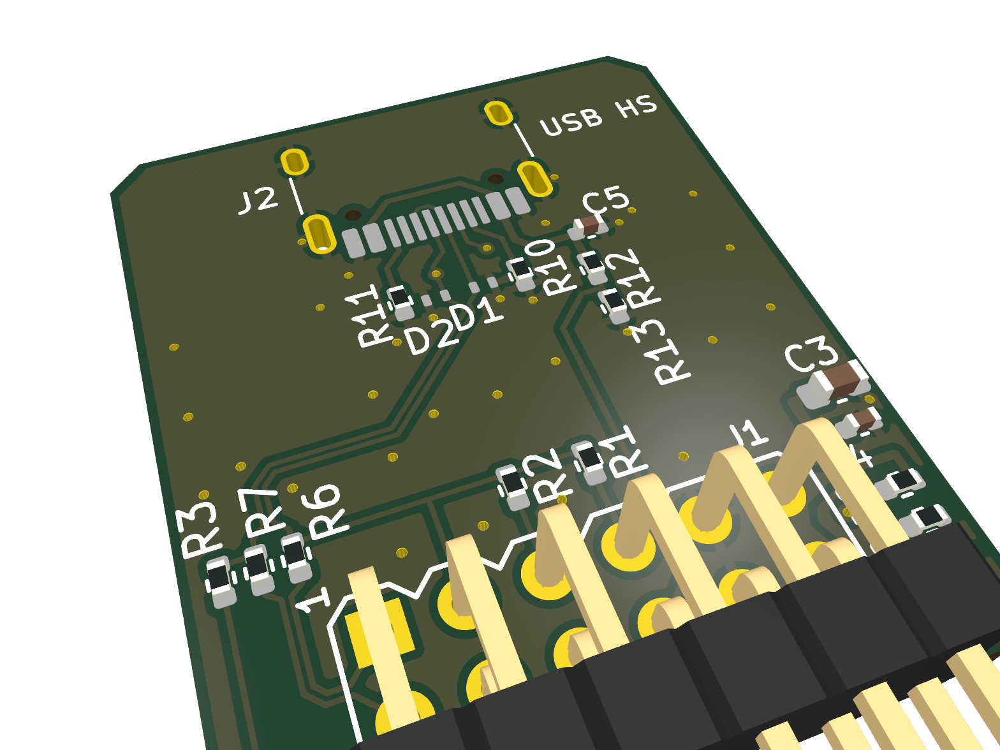
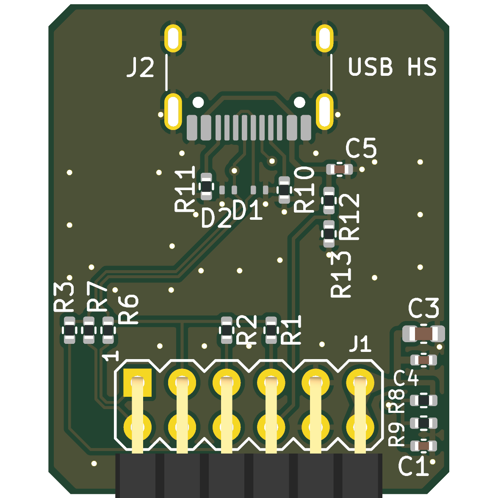

# Pmod USB HS Single (Rev. A)

USB 2.0 HS デバイスを Pmod 1 個でつなぐ基板。Gowin USB 2.0 SoftPHY の Single LVDS 配線から
D- 側の比較器を省き、FPGA ピン 7 本 + VBUS 検出 1 本に収めた。KiCad 10。

- FPGA 側: `rtl/usb/gowin/usb_phy_gowin_sl.v` の `CMP1=1`
- 設計検討: [`../../SINGLE_PMOD.md`](../../SINGLE_PMOD.md)
- PHY の動作確認: SLogic16U3 で HS を実機確認済み (`eda/slogic16u3_usb2`、`make HS=1 CMP1=1`)

 

状態: **設計のみ (未発注・実機未確認)**。ERC / DRC (回路図との一致を含む) はエラー 0。

## 仕様

- 外形 22.86 × 27.94 mm、2 層 1.6 mm (FR4)、角 1.27 mm 面取り。
- J1: Pmod 2x6 直角ヘッダ (TangFPGAExtensions の `Conn_Pmod_Spec_B_Thin`)、基板下端。
- J2: USB Type-C レセプタクル、HRO TYPE-C-31-M-12 (USB 2.0 の 16 ピン)、基板上端。デバイス (UFP) 専用。
- D+/D- の結合ペア:
  - 寸法は Pmod_RPiCamera と同じ 0.1661 / 0.127 mm (USB ネットクラス)。
  - F.Cu のみで引き、B.Cu は全面 GND。
  - B.Cu を通るのは、コネクタのピン列の D-/D+ 入れ替え 1 か所 (約 2 mm) だけ。ほかに VREF (直流) がヘッダの列の間で B.Cu を通る。
- ESD 保護: D1/D2 は TPD1E05U06DPY (0.42 pF、1 ライン 1 個)。
- VBUS は電源に使わず、検出だけに使う。R12/R13 で 5 V を 3.0 V に分圧する (LVCMOS33 の VIH 2.0 V を超える)。

## 回路 (TN710 USB2.0-RC、Arora-V の値)

| Ref | 値 | 役割 |
|---|---|---|
| R6, R7 | 100 Ω | dx 対の直列抵抗 (TN710 R6/R7)。送信と差動受信がこの対を共用する |
| R2, R3 | 33 Ω | HS 終端 (ピンの Low 駆動 + 33 Ω、TN710 R2/R3 は 36 Ω。JLC の Basic 部品にするため 33 Ω に変更、終端は約 42 Ω の見込み) |
| R1 | 1.5 kΩ | D+ プルアップ。PULLUP が High でアタッチ |
| R8 / R9 | 4.7 kΩ / 200 Ω | VREF = 3.3 V × 200 / 4900 ≈ 135 mV (D+ 比較器の N 側。TN710 は 1.8 kΩ / 75 Ω で 132 mV、Basic 部品にするため変更) |
| C1 | 1 µF | VREF のバイパス |
| R10, R11 | 5.1 kΩ | CC1/CC2 の Rd (UFP) |
| R12 / R13 | 100 kΩ / 150 kΩ | VBUS 検出の分圧 |
| C5 | 1 µF | VBUS |
| C3, C4 | 10 µF, 100 nF | 3.3 V のデカップリング |

- TN710 の R4/R5 (Dual LVDS の差動受信用 0 Ω) は Single 配線にはないので欠番にしてある。
- TN710 の定数表に合わせるため、部品番号はそのまま使っている (R2/R3 と R8/R9 の値は上記のとおり変更)。

## ピン割り当て

| Pmod | 信号 | FPGA の IO | Tang Primer 25K (pmod2) |
|---|---|---|---|
| 1 / 7 | DX_P / DX_N | LVCMOS33D 双方向 (ELVDS_IOBUF) | G11 / G10 |
| 2 / 8 | D+ / VREF | LVDS25 入力 (D+ 比較器) | D11 / D10 |
| 3 / 9 | TERM_DP / TERM_DN | LVCMOS33 双方向 (Low で終端、Hi-Z で FS 受信) | B11 / B10 |
| 4 | PULLUP | LVCMOS33 出力 | C11 |
| 10 | VBUS_DET | LVCMOS33 入力 (PULL_MODE=DOWN) | C10 |
| 5, 11 / 6, 12 | GND / 3.3 V | | |

制約の例と PHY のつなぎ方は `../../SINGLE_PMOD.md` の §3 と §4 にある。

## 配線の要点

- **コネクタのピン列**: 1 列の SMD パッドで D+/D- が交互に並ぶ (B6 D+、A7 D-、A6 D+、B7 D-)。
  - B6 と A6 はピン列の上 (コネクタ本体の下) でつないだ。
  - B7 は B.Cu に潜って D+ の下をくぐり、A7 側の D- に合流する。
  - VBUS の 2 パッドも同様に、ピン列の上でつないだ。
- **ペアからヘッダまで**: ESD のあと、D+/D- はペアのまま斜めに下りてヘッダ直上の TN710 網に入る。
  - D+ はバス状に分岐する: R6、比較器 → Pmod 2 (直進)、R2 → Pmod 3、R1 → Pmod 4。
  - D- は左へ分かれて R7 と R3 に入る。
- **dx 対 (R6/R7 → Pmod 1/7)**: HS の送受信を担うペア。
  - R6/R7 を横に並べ、出口からすぐ結合ペアにしてヘッダの左を下ろす。
  - ヘッダの 2 列の間に横から入り、そこで対称に分かれる (P は上の Pmod 1、N は下の Pmod 7)。
  - Pmod の差動ペアは上下の列で向かい合うので、上から入ると N だけが 2.54 mm 長くなる。横から入ってこれを避けた。
- **D- の終端 (R3 → Pmod 9)**: 基板の左端を下り、ヘッダ外側の列の下を通って Pmod 9 に下から入る。
- **VREF と VBUS_DET**:
  - VREF は Pmod 8 から B.Cu でヘッダの列の間を右へ抜け、ビアで表に戻る。直流で、真上 (F.Cu) に高速の信号はない。
  - VBUS_DET は Pmod 4 と 5 の間からヘッダの列の間 (F.Cu) に入り、Pmod 10 に届く。
- **配線長** (`gen_pcb.py` の基板から計測):
  - DX_P (R6 → Pmod 1) は 6.2 mm、DX_N (R7 → Pmod 7) は 6.7 mm。P/N の差は約 0.5 mm (約 3 ps)。
  - D- の終端経路 (R3 → Pmod 9) は 15.8 mm、D+ 側 (R2 → Pmod 3) は 2.5 mm。

## 製造データ

`tools/build.sh` が ERC / DRC (回路図との一致を含む) を通してから `fab/` を作る。

| ファイル | 内容 |
|---|---|
| `fab/Pmod_USB_HS_Single_gerber.zip` | ガーバー (F/B Cu、Mask、Silk、F.Paste、Edge) とドリル (PTH/NPTH 別) |
| `fab/Pmod_USB_HS_Single_bom.csv` | 部品表 (LCSC 番号、MPN 付き) |
| `fab/Pmod_USB_HS_Single_pos.csv` | 実装位置 (表面のみ) |
| `fab/jlc/Pmod_USB_HS_Single_jlc_bom.csv`, `_jlc_cpl.csv` | JLC 実装用の BOM / CPL (`tools/jlc_files.py`、LCSC 番号のない J1 は除く) |
| `fab/Pmod_USB_HS_Single_schematic.pdf` | 回路図 |
| `fab/*.png` | 3D レンダリング |
| `fab/erc.rpt`, `fab/drc.rpt` | 検査結果 (ライブラリ表の警告はヘッドレス環境に由来) |
| `fab/lcsc/Pmod_USB_HS_Single_lcsc_5pcs.csv` | LCSC 部品購入用 (5 枚分、J1 含む、2026-10-29 時点で約 $5.84)。`tools/lcsc_order.py N` で N 枚分を作り直す (LCSC に問い合わせて最小発注数・単価・在庫を反映、要ネットワーク、`build.sh` には含まない) |

回路図 (`tools/gen_sch.py`) と基板 (`tools/gen_pcb.py`、配置・配線・ベタを座標で記述) は最初スクリプトから生成した。
その後、基板は KiCad で手を入れている (F.Cu の +3V3 ベタ、配線の調整) ので、GUI 側を正とする。
`build.sh` は既定では再生成しない。`REGEN=1 tools/build.sh` で再生成すると GUI での修正は消える。
部品の LCSC 番号と MPN は `tools/gen_sch.py` の `PARTS` が正。変えたら `tools/gen_sch.py` → `tools/update_fields.py`
(配線を残したまま基板側の部品の欄だけ更新) → `tools/build.sh`。
裏面シルク (ロゴ、基板名 / 版 / 日付 / 作者、ピン表) は `tools/silk.py` が持つ。単体で実行すると、基板の裏面シルクだけをその場で入れ直す (銅箔は触らない)。
表面のリファレンス文字は circuitpnr (`cpnr labels`) で置き、`cpnr label-check` で重なり・パッド干渉・取り違えがないことを確かめた
(`gen_pcb.py` は非表示で作るので、`REGEN=1` のあとは置き直しが要る)。

## 部品

LCSC 番号は 2026-10-29 時点。JLC の Basic 部品があるものはそれを選んだ (JLC と LCSC の在庫は別)。JLC の拡張部品 (手数料あり) は D1/D2 と J2 の 2 種類、R13 は Preferred Extended。

| Ref | 部品 | LCSC | 備考 |
|---|---|---|---|
| J1 | 2x6 2.54 mm 直角ピンヘッダ | (C41417354) | 手はんだ。回路図には LCSC 番号なし。購入一覧では左の候補を使う (ピン長・本体寸法をフットプリントと要照合) |
| J2 | HRO TYPE-C-31-M-12 | C165948 | 16 ピン (USB 2.0)。外形 7.3 mm、前端は基板端から約 0.65 mm 出る (要実物確認) |
| D1, D2 | TI TPD1E05U06DPYR | C436349 | X1SON-2 (0.6 × 1.0 mm)。手はんだは難しい。同名の互換品 (TECH PUBLIC C907835、Leiditech C2972479) はクランプ電圧などが違うので使わない |
| R1 | 1.5 kΩ 1% 0402 UNI-ROYAL 0402WGF1501TCE | C25867 | |
| R2, R3 | 33 Ω 1% 0402 UNI-ROYAL 0402WGF330JTCE | C25105 | JLC Basic。LCSC 在庫切れのときは購入一覧で YAGEO RC0402FR-0733RL (C138002) に置き換わる |
| R6, R7 | 100 Ω 1% 0402 UNI-ROYAL 0402WGF1000TCE | C25076 | |
| R8 / R9 | 4.7 kΩ / 200 Ω 1% 0402 UNI-ROYAL | C25900 / C25087 | JLC Basic |
| R10, R11 | 5.1 kΩ 1% 0402 UNI-ROYAL 0402WGF5101TCE | C25905 | |
| R12 / R13 | 100 kΩ / 150 kΩ 1% 0402 UNI-ROYAL | C25741 / C25755 | |
| C1, C5 | 1 µF X5R 0402 Samsung CL05A105KA5NQNC | C52923 | LCSC で在庫切れのときは、購入一覧で YAGEO CC0402KRX5R7BB105 (C325464、16 V) などに置き換わる |
| C3 | 10 µF 10 V X5R 0603 Samsung CL10A106KP8NNNC | C19702 | |
| C4 | 100 nF X7R 0402 Samsung CL05B104KB54PNC | C307331 | LCSC 在庫切れのときは、購入一覧で Samsung CL05B104KO5NNNC (C1525、16 V) に置き換わる |

## 未確定事項

- **差動インピーダンス**: Pmod_RPiCamera と同じ寸法 (100 Ω 想定、2 層 1.6 mm でのペア結合が主体) で、USB の 90 Ω に合わせた計算はしていない。
  - 基板上の D+/D- は約 15 mm で、FPGA ボード側の Pmod 配線とヘッダの方が支配的。
  - 製造業者のスタックアップで要再計算。
- **定数**: R2/R3 と R8/R9 以外は TN710 の Arora-V の値そのままで、HS の振幅 (400 mV) と終端 (33 Ω + IO の ON 抵抗) は未実測。SLogic16U3 の実装値も不明。
  - R6/R7 (直列) と IO の DRIVE で振幅が決まる。
- **Pmod 経由の HS 品質**: 送受信が同じ dx 対を通るので、ヘッダから FPGA までの未整合区間が両方向に効く。`SINGLE_PMOD.md` §7 を参照。
- **Tang Primer 25K の pmod2**: G11/G10 を ELVDS_IOBUF (エミュレート差動の出力) にできるか、960 MHz の FCLK が届くかは合成で未確認。
- **J2**: 基板端に対する前後位置。
